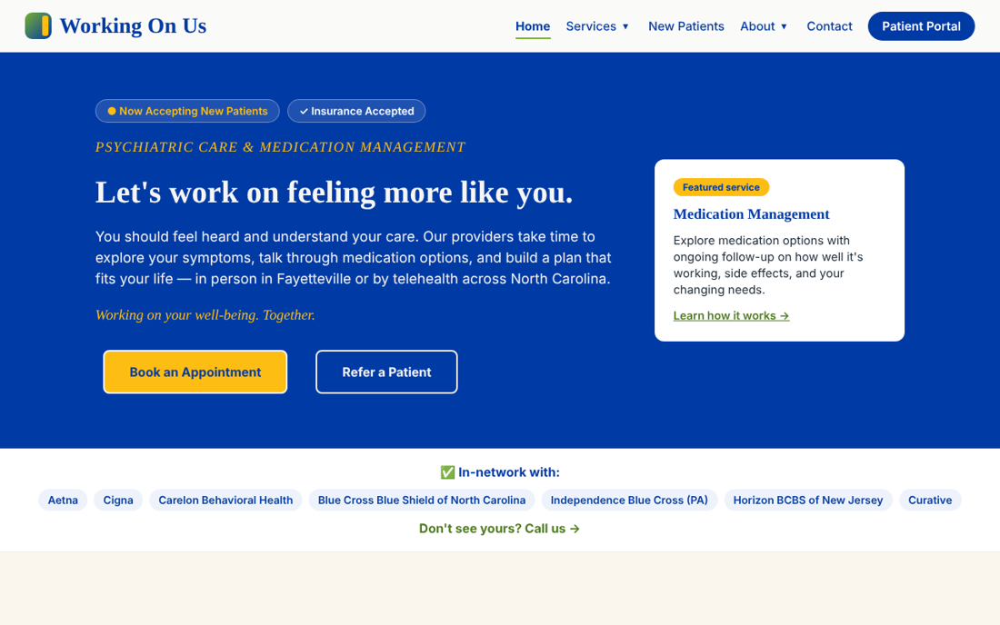
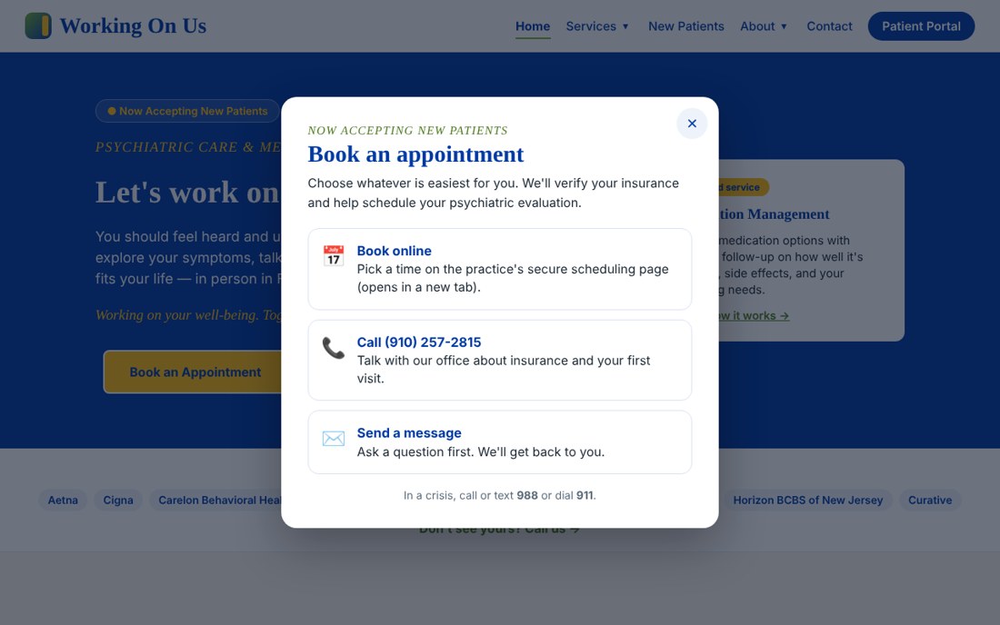
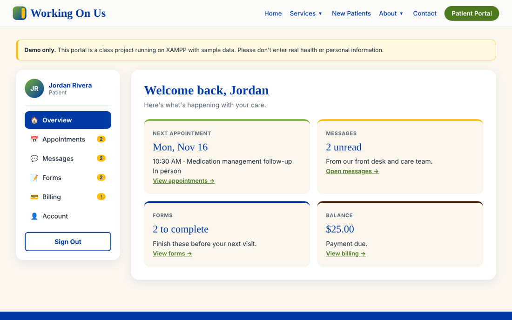
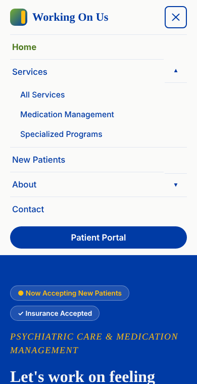

# Working On Us — Website Rebuild

A hand-coded rebuild of the website for **Working On Us Behavioral Health & Family Services**, a psychiatric medication management and family services practice in Fayetteville, North Carolina. Built as my final project for CSC-3090 Web Development at Methodist University.

**🔗 Live site: [allen-gaines.github.io/workingonus](https://allen-gaines.github.io/workingonus/)**



## Features

- **10 public pages:** Home, Services, Medication Management, Specialized Programs, New Patients & FAQ, About, Our Team, Contact, Privacy/HIPAA/Accessibility, and a custom 404 page
- **Navigation:** sticky header, dropdown submenus, mobile hamburger menu, breadcrumbs, back-to-top button
- **Interactive pieces:** "Book an Appointment" modal with a focus trap, programs carousel (arrows, dots, swipe, autoplay with pause), FAQ accordion with live search, scroll-reveal animations
- **Form validation:** contact form with per-field errors, a character counter, and a spam honeypot
- **Patient portal demo:** sign-in plus a dashboard for appointments, messages, forms, and billing, using sample data
- **Responsive and accessible:** works from phones to desktops, has a skip link, full keyboard support, labeled forms, and honors reduced-motion settings

| Booking modal | Portal dashboard | Mobile menu |
|---|---|---|
|  |  |  |

> **Demo login:** `demo@workingonus.com` / `Demo1234`
> The portal is a class project with made-up data. It isn't the practice's official portal, so don't enter real health information.

## Built with

- **HTML5**: semantic structure, one `h1` per page
- **CSS3**: brand colors in CSS variables, Flexbox and Grid, media queries
- **Vanilla JavaScript**: no frameworks, with `js/script.js` organized into 11 commented sections
- **PHP 8 + MySQL**: the full version, for XAMPP, adds real accounts, hashed passwords, full CRUD, and a contact form saved to the database, with CSRF, SQL injection, XSS, and IDOR protection. GitHub Pages can't run PHP, so this live site uses the JavaScript version of the portal.

## Project structure

```
├── index.html                 Home
├── services.html  medication-management.html  programs.html
├── faq.html  about.html  team.html  contact.html  privacy.html  404.html
├── portal.html  dashboard.html   Patient portal demo
├── css/style.css              One stylesheet for every page
├── js/script.js               Site-wide JavaScript
├── js/portal.js               Portal demo logic
├── images/                    Favicon + original SVG illustrations
└── screenshots/               Images used in this README
```

## Run it locally

No build step is needed. Clone the repo and open `index.html` in a browser, or serve the folder:

```bash
git clone https://github.com/Allen-Gaines/workingonus.git
cd workingonus
python -m http.server 8000   # then visit http://localhost:8000
```

## Credits

- Practice information is adapted from [workingonus.org](https://workingonus.org).
- The illustrations, layout, and code are my own work.
- Fonts: [Fraunces and Inter](https://fonts.google.com/) under the SIL Open Font License.

---

**Allen Gaines** · B.S. Cybersecurity & IT, Methodist University
